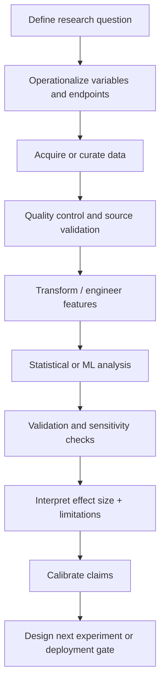

# Methods Matrix

| Capability | EEG/ERP | Spectral EEG | Eye tracking | fMRI | Behavioral / Affective | Clinical AI/RWE |
|---|:---:|:---:|:---:|:---:|:---:|:---:|
| Controlled perturbation design | X | X | X |  | X |  |
| Event synchronization | X | X | X |  | X | X |
| Signal-quality gating | X | X | X | X |  | X |
| Artifact / outlier handling | X | X | X | X |  | X |
| Repeated-measures inference | X | X | X |  | X |  |
| Mixed-effects modeling |  |  | X |  |  |  |
| Moderation / interaction models | X | X | X | X | X | X |
| Survey / psychometric measurement |  |  |  |  | X |  |
| Semantic scoring |  |  |  |  | X |  |
| Qualitative coding |  |  |  |  | X | X |
| Longitudinal reconstruction |  |  |  |  |  | X |
| Data harmonization |  |  |  | X | X | X |
| NLP / information extraction |  |  |  |  |  | X |
| Rare-outcome prediction |  |  |  |  |  | X |
| Calibration / threshold analysis |  |  |  |  |  | X |
| Grouped / temporal validation |  |  |  |  |  | X |
| Reproducible analysis | X | X | X | X | X | X |
| Human-subjects / privacy governance | X | X | X | X | X | X |
| Claims calibration | X | X | X | X | X | X |
| Scientific communication | X | X | X | X | X | X |

## Representative technical tools

**Python:** pandas, NumPy, scikit-learn, LightGBM, XGBoost, Optuna, Jupyter  
**R:** RStudio, RMarkdown, regression, moderation, repeated-measures and mixed-effects workflows  
**MATLAB / EEG:** EEGLAB, ERPLAB, ICA/ICLabel, spectral analysis; secondary exposure to Brainstorm and EMSE Suite  
**Experimental systems:** BioSemi ActiveTwo, Net Station, EyeLink 1000 Plus, PsychoPy, E-Prime, Presentation  
**Behavioral research:** Qualtrics, SPSS, SemDis, structured qualitative coding  
**Clinical systems:** SQL, PostgreSQL, FHIR R4, HL7, X12, REST, Azure  
**Research operations:** Git/GitHub, IRB workflows, de-identification, HIPAA, ICH-GCP, provenance and source-lineage practices

## Methodological pattern

Across modalities, the workflow remains consistent:

