<div align="center">


# Joshua Daniel Upshaw, PhD

### Clinical Data Science · Cognitive Neuroscience · Applied Machine Learning · Real-World Evidence

**Research and development portfolio spanning human neuroscience, multimodal measurement, clinical data science, and healthcare AI.**

[](https://scholar.google.com/citations?user=XAe-ESMAAAAJ&hl=en)
[](https://www.linkedin.com/in/joshua-upshaw-ph-d/)
[](mailto:jupshaw2010@gmail.com)

`EEG / ERP` · `Spectral EEG` · `1000 Hz Eye Tracking` · `fMRI` · `Longitudinal EHR` · `Clinical NLP` · `Rare-Outcome ML`

[Executive Summary](docs/executive_summary.md) · [Flagship Projects](#flagship-projects) · [Methods](METHODS_MATRIX.md) · [Technical Toolkit](TECHNICAL_TOOLKIT.md) · [KSA Evidence](KSA_EVIDENCE_MATRIX.md)

</div>

---

## What I do

I build research systems that turn complex human and clinical data into **defensible evidence and actionable technical decisions**. My work spans controlled behavioral experiments, EEG/ERP and spectral signal analysis, 1000 Hz eye tracking, secondary fMRI analysis, longitudinal EHR data, clinical NLP, rare-outcome machine learning, and prospective study design.

> [!IMPORTANT]
> **The through-line is measurement discipline.** Define the phenomenon carefully, protect signal and data quality, match the analysis to the decision, calibrate claims to the evidence, and design the next experiment around what remains uncertain.

### Portfolio at a glance

| Human neuroscience | Clinical data science | R&D leadership |
|---|---|---|
| **EEG / ERP:** BioSemi ActiveTwo, Net Station, ERP and spectral analysis | **24,000+ patients:** longitudinal oncology research cohort | **NSF SBIR PI:** led a federally funded healthcare AI R&D program |
| **1000 Hz eye tracking:** fixation, saccade, blink, pupil, AOI analysis | **200,000+ workflow records:** reconstructed and analyzed real-world clinical events | **Cross-functional execution:** science, engineering, clinical operations, product, compliance |
| **fMRI:** ABCD secondary analysis of reward/risk circuitry | **Clinical NLP + ML:** extraction, rare-outcome prediction, grouped and temporal validation | **Evidence governance:** requirements, provenance, validation, claims, and deployment gating |

---

## R&D evolution

My research career has progressed from measuring human behavior under controlled conditions to building evidence systems for complex clinical and technical environments.

```mermaid
flowchart LR
    A[Behavioral science] --> B[Human experimental neuroscience]
    B --> C[EEG, ERP, eye tracking]
    C --> D[Neuroimaging and multimodal analysis]
    D --> E[Longitudinal clinical data science]
    E --> F[Applied ML and healthcare AI]
    F --> G[Research-to-product leadership]

    classDef early fill:#EEF4FF,stroke:#4A76A8,color:#1F2937;
    classDef mid fill:#F5F0FF,stroke:#7C5CBF,color:#1F2937;
    classDef late fill:#EDF7F0,stroke:#3D8B5A,color:#1F2937;
    class A,B,C early;
    class D mid;
    class E,F,G late;
```



This progression supports a repeatable operating model:

<div align="center">

### question → measurement → data → model → validation → bounded claim → next experiment → implementation decision

</div>

For the full framework, see [RESEARCH_AND_DEVELOPMENT_APPROACH.md](RESEARCH_AND_DEVELOPMENT_APPROACH.md).

---

## Choose your path

| If you are... | Recommended path |
|---|---|
| **Executive or hiring leader** | [Executive Summary](docs/executive_summary.md) → [Flagship Projects](#flagship-projects) → [KSA Evidence Matrix](KSA_EVIDENCE_MATRIX.md) |
| **Scientist or research lead** | [Flagship Projects](#flagship-projects) → [Methods Matrix](METHODS_MATRIX.md) → [`methods/`](methods/) |
| **Data scientist or ML engineer** | [Clinical AI project](projects/05_clinical_ai_oncology/) → [Model Validation](methods/model_validation.md) → [`examples/`](examples/) |
| **Neuroscience / neurotech team** | EEG → spectral EEG → eye tracking → fMRI projects, then [Technical Toolkit](TECHNICAL_TOOLKIT.md) |
| **Clinical / regulated R&D team** | [Clinical AI](projects/05_clinical_ai_oncology/) → [Research Governance](methods/research_governance.md) → [Data & IP Policy](PUBLIC_DATA_AND_IP_POLICY.md) |

---

# Flagship projects

## 1. EEG / ERP, digital distraction and cognitive control

**Question:** Does an ecologically familiar auditory cue alter cognitive-control processing?

**Methods:** BioSemi EEG · Navon local-global oddball · ERP analysis · ICA / ICLabel · trial-level regression · reaction time and accuracy

**Selected findings:** Smartphone-sound trials were slightly slower; N2 differed by sound condition while P3 did not. The project illustrates how behavioral and neural measures can diverge and why interpretation should remain tied to the specific process measured.

**Evidence:** 

[View project →](projects/01_eeg_erp_digital_distraction/)

---

## 2. Spectral EEG, mindfulness and cognitive control

**Question:** How do notifications and a brief mindfulness induction alter task-locked neural dynamics?

**Methods:** 32-channel EEG · ASR · extended Infomax ICA · ICLabel · theta / alpha / beta power · theta/beta ratio · ERP analysis

**Selected findings:** Notifications altered spectral power and selected condition contrasts emerged, but the omnibus group × sound TBR interaction was not significant. The project demonstrates preprocessing rigor, multimodal inference, and disciplined handling of mixed and null findings.

**Evidence:** 

[View project →](projects/02_spectral_eeg_mindfulness/)

---

## 3. 1000 Hz eye tracking, emotional attention

**Question:** How do auditory notifications interact with emotional visual attention?

**Methods:** EyeLink 1000 Plus · PsychoPy · 1000 Hz gaze acquisition · 9-point calibration · AOI analysis · fixation · saccade · blink · pupil · mixed models

**Selected findings:** Angry faces delayed first fixation relative to happy faces, and notification trials increased pupil variability relative to silence. Several other endpoints were null, helping localize rather than generalize the observed effects.

**Evidence:** 

[View project →](projects/03_eye_tracking_emotional_attention/)

---

## 4. fMRI, screen time and reward processing

**Question:** Is youth screen time associated with reward/risk circuitry, and is that relationship moderated by caregiver warmth?

**Methods:** ABCD secondary analysis · MID task · ROI BOLD · regression · moderation · transformed predictors · motion / outlier exclusion · R / RMarkdown

**Selected findings:** A significant right anterior-insula interaction was observed, but the adjusted R² was only 0.0073. The project is included because it demonstrates the distinction between statistical significance and explanatory magnitude.

**Evidence:** 

[View project →](projects/04_fmri_reward_processing/)

---

## 5. Clinical AI, oncology real-world evidence

**Question:** Can heterogeneous oncology records support clinical information extraction, denial-risk triage, workflow analysis, and prospective intervention design?

**Methods:** Longitudinal EHR data · clinical NLP · cohort reconstruction · source reconciliation · LightGBM · grouped and temporal validation · PR-AUC · calibration · timing analysis · simulation · prospective telemetry design

**Selected findings:** Combined information extraction reached approximately **0.97 F1**. Rare-outcome denial prediction showed meaningful discrimination and precision-recall lift, while temporal degradation and retrospective workflow limitations were treated as evidence requiring stricter validation and prospective measurement rather than as problems to hide.

**Evidence:** 

[View project →](projects/05_clinical_ai_oncology/)

---

# Methods and technical toolkit

| Domain | Core methods | Tools / technologies |
|---|---|---|
| **Neural signals** | EEG acquisition, ERP analysis, task-locked spectral power, artifact detection, ICA, component classification | `BioSemi ActiveTwo` `Net Station` `EEGLAB` `ERPLAB` `MATLAB` `ICLabel` `Brainstorm` |
| **Eye tracking** | Calibration / validation, AOI analysis, first fixation, saccades, blinks, pupil magnitude and variability, trial QC | `EyeLink 1000 Plus` `PsychoPy` `Data Viewer` `R` |
| **Behavioral science** | Experimental paradigms, survey design, psychometrics, semantic scoring, qualitative coding | `PsychoPy` `E-Prime` `Presentation` `Qualtrics` `SemDis` `SPSS` |
| **Neuroimaging** | ROI BOLD analysis, moderation, transformed predictors, motion / outlier exclusion | `ABCD` `MID task` `R` `RStudio` `RMarkdown` |
| **Clinical data science** | Cohort construction, longitudinal case reconstruction, source reconciliation, data-quality engineering, clinical NLP | `Python` `pandas` `SQL` `PostgreSQL` `Jupyter` |
| **Machine learning** | Rare-outcome modeling, grouped / temporal validation, ROC-AUC, PR-AUC, calibration, threshold and workload analysis | `scikit-learn` `LightGBM` `XGBoost` `Optuna` |
| **Healthcare systems** | Terminology normalization, provenance, interoperability, data contracts | `FHIR R4` `HL7` `X12` `REST APIs` `Azure` |
| **Research governance** | IRB / human subjects, de-identification, HIPAA, GCP, claims calibration, reproducibility | `CITI GCP` `Human Subjects` `HIPAA` `Git` `Versioned analyses` |

### Technical deep dives

- [Methods Matrix](METHODS_MATRIX.md), project-by-project methods and evidence
- [Technical Toolkit](TECHNICAL_TOOLKIT.md), tools mapped to actual use cases
- [EEG Processing](methods/eeg_processing.md)
- [Eye Tracking](methods/eye_tracking.md)
- [Neuroimaging](methods/neuroimaging.md)
- [Clinical Data Science](methods/clinical_data_science.md)
- [Model Validation](methods/model_validation.md)
- [Scientific Inference](methods/scientific_inference.md)
- [Research Governance](methods/research_governance.md)

---

# How I evaluate evidence

I deliberately keep the following distinctions separate because each implies a different level of confidence, action, and technical readiness.

| Evidence distinction | Why it matters |
|---|---|
| **Observed vs. simulated** | Simulation can guide design, but it does not establish real-world effect |
| **Association vs. prediction** | Predictive usefulness does not establish mechanism or causality |
| **Prediction vs. intervention effect** | Identifying risk does not prove that acting on a prediction changes outcomes |
| **Retrospective vs. prospective performance** | Historical validation may not survive temporal or operational change |
| **Statistical significance vs. practical magnitude** | A small p-value does not imply a meaningful effect |
| **Model problem vs. measurement problem** | Better algorithms cannot fix unreliable labels, timing, or source data |

> [!NOTE]
> This evidence discipline influences not only scientific reporting, but also model governance, product requirements, pilot design, deployment decisions, and external technical claims.

---

# Core knowledge, skills, and abilities

<table>
<tr>
<td valign="top" width="50%">

### Research and measurement

- Experimental design and hypothesis decomposition
- Human-subjects study execution
- Behavioral and psychometric measurement
- EEG / ERP and spectral signal processing
- Eye-tracking and physiological measurement
- Neuroimaging secondary analysis
- Longitudinal clinical-data curation
- Statistical modeling and rare-outcome ML

</td>
<td valign="top" width="50%">

### Rigor, governance and leadership

- Leakage control, calibration and temporal validation
- Data-quality engineering and source reconciliation
- Reproducibility, provenance and requirements traceability
- Technical claims and model-risk governance
- IRB, privacy and clinical-data governance
- Scientific peer review and research ethics service
- Cross-functional technical translation
- Research-program and research-to-product leadership

</td>
</tr>
</table>

See [KSA_EVIDENCE_MATRIX.md](KSA_EVIDENCE_MATRIX.md) for evidence linking each capability to specific projects and outcomes.

---

# Additional projects and scientific breadth

Not every project belongs in the flagship set. The additional-project portfolio demonstrates breadth across behavioral science, psychophysiology, health behavior, social cognition, and clinically relevant research methods.

| Area | Example work | Capabilities demonstrated |
|---|---|---|
| **Developmental psychophysiology** | Emotion regulation and executive-control EEG research | High-density EEG, ERP processing, experimental QA, protocol execution |
| **Imagination and neurocognition** | Frontoparietal-network and imagination research | Neuroimaging interpretation, cognitive theory, scientific presentation |
| **Behavioral health / substance use** | NIH-supported alcohol, anxiety and behavioral research | Experimental design, quantitative analysis, qualitative coding, confidentiality |
| **Social cognition** | Personality, perspective taking and diversity ideologies | Survey design, field/lab research, SPSS, behavioral modeling |
| **Mindfulness and health behavior** | Brief mindfulness and healthier food-choice research | Behavioral intervention research, interdisciplinary collaboration |
| **Creativity and digital behavior** | Social media, divergent thinking, creative achievement | Psychometrics, semantic scoring, behavioral inference |

[Explore additional projects →](projects/06_additional_projects/)

---

# Scientific leadership and communication

Research impact depends on whether evidence can be understood and acted upon by people outside the originating discipline. My experience includes:

- **Instructor of record** for university psychology courses
- **Ad hoc peer reviewer** for multiple scientific journals
- **IRB Research Ethics Committee** service
- Scientific talks, posters, symposium contributions, and executive presentations
- Cross-functional communication across scientists, engineers, clinicians, operations teams, executives, customers, and investors
- Translation of technical findings into decisions, risks, limitations, and next actions

[Scientific leadership and service →](docs/scientific_leadership_and_service.md)

---

# Public-safe reproducibility

The [`examples/`](examples/) and [`notebooks/`](notebooks/) folders contain synthetic demonstrations designed to make analytical reasoning inspectable without releasing restricted data or proprietary code.

### Included demonstrations

- EEG signal QC and band-power workflow
- Eye-tracking trial QC and physiological endpoint analysis
- Rare-outcome clinical ML with grouped vs. temporal validation, PR-AUC, calibration, and workload-aware thresholding

> [!CAUTION]
> These demonstrations are **not** the original participant-level or clinical datasets and are **not** production Hidalga code. They are public-safe examples of the underlying analytical concepts.

---

# Repository map

```text
.
├── README.md                         Portfolio landing page
├── START_HERE.md                     Guided review paths
├── KSA_EVIDENCE_MATRIX.md            Capability → evidence → impact
├── METHODS_MATRIX.md                 Methods by project and research domain
├── TECHNICAL_TOOLKIT.md              Tools mapped to actual use
├── RESEARCH_AND_DEVELOPMENT_APPROACH.md
│                                     End-to-end R&D operating model
├── projects/                         Flagship + additional case studies
├── methods/                          Reusable technical method notes
├── examples/                         Public-safe executable demonstrations
├── notebooks/                        Jupyter versions of selected demos
├── docs/                             Executive summary, publications, training, service
├── assets/                           Public-safe figures and diagrams
└── .github/                          Lightweight repository validation
```

---

# Publications, presentations and training

- [Selected publications](docs/publications.md)
- [Selected presentations](docs/presentations.md)
- [Certifications and professional training](docs/certifications.md)
- [Research principles](docs/research_principles.md)
- [Scientific leadership and service](docs/scientific_leadership_and_service.md)

---

# Research portfolio PDF

📄 A polished narrative version of the portfolio is available at [`docs/Joshua_Upshaw_Research_Portfolio.pdf`](docs/Joshua_Upshaw_Research_Portfolio.pdf).

---

# Data, IP and privacy

> [!WARNING]
> This repository intentionally excludes PHI, clinic-level raw exports, participant-level restricted data, proprietary payer criteria, production credentials, confidential source reports, licensed research stimuli, and protected company IP.

See [PUBLIC_DATA_AND_IP_POLICY.md](PUBLIC_DATA_AND_IP_POLICY.md) for the public-release boundaries used throughout this repository.

---

<div align="center">

### Research should make uncertainty smaller, decisions better, and the next experiment clearer.

[Start here](START_HERE.md) · [Executive summary](docs/executive_summary.md) · [Projects](projects/) · [Methods](methods/) · [Contact](mailto:jupshaw2010@gmail.com)

</div>
