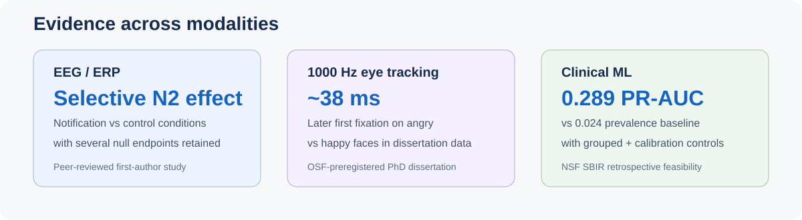
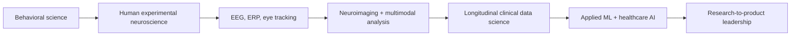

## Joshua Daniel Upshaw, PhD

Research and development portfolio spanning human neuroscience, multimodal measurement, clinical data science, applied machine learning, and healthcare AI.

`EEG / ERP` · `Spectral EEG` · `1000 Hz Eye Tracking` · `fMRI` · `Longitudinal EHR` · `Clinical NLP` · `Rare-Outcome ML`

[Executive Summary](docs/executive_summary.md) · [Project Index](PROJECTS.md) · [Methods](METHODS_MATRIX.md) · [Technical Toolkit](TECHNICAL_TOOLKIT.md) · [KSA Evidence](KSA_EVIDENCE_MATRIX.md)

---

## What I do

I build research systems that turn complex human and clinical data into **defensible evidence and actionable technical decisions**. My work spans controlled behavioral experiments, neural and physiological measurement, longitudinal clinical-data curation, clinical NLP, rare-outcome machine learning, validation, and prospective study design.

> [!IMPORTANT]
> **The through-line is measurement discipline:** define the phenomenon carefully, protect data and signal quality, match analysis to the decision, calibrate claims to the evidence, and use uncertainty to design the next experiment.

### Portfolio at a glance

| Human neuroscience | Clinical data science | R&D leadership |
|---|---|---|
| EEG/ERP, spectral EEG, 1000 Hz gaze, pupil and saccades, fMRI | 24,000+ patients, 200,000+ workflow records, 148,000+ clinical notes | NSF SBIR PI, cross-functional R&D, research-to-pilot translation |
| Experimental design, signal QC, repeated-measures inference | Clinical NLP, longitudinal reconstruction, rare-outcome ML | Requirements, provenance, validation, model risk, claims governance |

  

---

## R&D evolution

**Operating model:** question -> measurement -> data -> model -> validation -> bounded claim -> next experiment -> implementation decision

[View the full R&D approach](RESEARCH_AND_DEVELOPMENT_APPROACH.md)

---

## Flagship projects

| Project | Evidence | Core methods | What it demonstrates |
|---|---|---|---|
| [EEG/ERP: digital distraction](projects/01_eeg_erp_digital_distraction/) | Peer reviewed, first author | BioSemi EEG, ICA/ICLabel, ERP, trial-level behavior | Neural-signal QC, multimodal interpretation, bounded inference |
| [Spectral EEG + mindfulness](projects/02_spectral_eeg_mindfulness/) | Peer reviewed, first/corresponding author | ASR, ICA, theta/alpha/beta, TBR, repeated measures | Frequency-domain analysis, correction transparency, null-result discipline |
| [Eye tracking: emotional attention](projects/03_eye_tracking_emotional_attention/) | PhD dissertation, OSF preregistered | EyeLink 1000 Plus, fixation, saccade, blink, pupil, repeated measures | High-resolution multimodal measurement and participant/trial QC |
| [fMRI: reward processing](projects/04_fmri_reward_processing/) | Graduate neuroimaging project | ABCD, MID task, ROI BOLD, moderation | Effect-size judgment and observational-limitations awareness |
| [Clinical AI: oncology RWE](projects/05_clinical_ai_oncology/) | NSF SBIR Phase I retrospective feasibility | EHR/NLP, LightGBM, grouped/temporal validation, calibration | Clinical data curation, model risk, governance, prospective instrumentation |

[Compare all projects side by side](PROJECTS.md)

### Analytics, visualization and decision support

A reproducible, public-safe [Applied AI Analytics, Visualization & Decision Support report](projects/05_clinical_ai_oncology/analytics/REPORT.md) connects **predictive model validation**, **workflow signals** and **illustrative investment sensitivity** to explicit business decisions. Explore the [three analytical figures](projects/05_clinical_ai_oncology/analytics/README.md), [source code](projects/05_clinical_ai_oncology/analytics/visualize.py), [documented inputs](projects/05_clinical_ai_oncology/analytics/evidence_and_assumptions.json) and [tests](tests/test_analytics_visualization.py). Research metrics are historical aggregates; the labor model is hypothetical, not realized savings.

---

## Methods and technical depth

| Domain | Representative methods and tools |
|---|---|
| Neural signals | BioSemi ActiveTwo, Net Station, MATLAB, EEGLAB, ERPLAB, ASR, ICA, ICLabel, ERP, spectral analysis |
| Eye tracking | EyeLink 1000 Plus, PsychoPy, AOI/fixation, saccade, blink, pupil, participant/trial QC |
| Behavioral science | PsychoPy, E-Prime, Presentation, Qualtrics, SPSS, SemDis, psychometrics, qualitative coding |
| Neuroimaging | ABCD, MID task, ROI BOLD, R, RStudio, RMarkdown, moderation |
| Clinical data science | Python, pandas, SQL, PostgreSQL, longitudinal reconstruction, clinical NLP, provenance |
| Machine learning | scikit-learn, LightGBM, XGBoost, Optuna, ROC-AUC, PR-AUC, calibration, thresholds, temporal validation |
| Healthcare systems | FHIR R4, HL7, X12, REST APIs, Azure, terminology normalization |
| Research governance | IRB, HIPAA/HITECH, ICH-GCP, de-identification, reproducibility, claims calibration |

[Methods Matrix](METHODS_MATRIX.md) · [Technical Toolkit](TECHNICAL_TOOLKIT.md) · [KSA Evidence Matrix](KSA_EVIDENCE_MATRIX.md)

---

## Public-safe reproducibility

The [`examples/`](examples/) and [`notebooks/`](notebooks/) folders contain deterministic synthetic demonstrations of the analytical reasoning used across the portfolio.

- **EEG:** continuous signal -> events -> QC -> epochs -> condition-level ERP and band-power summaries
- **Eye tracking:** repeated participants/trials -> participant and trial QC -> within-subject contrasts
- **Clinical ML:** patient-grouped vs forward temporal validation -> explicit probability calibration -> PR-AUC/Brier/ECE -> workload-aware thresholding

CI runs the demos, analytical tests, repository-link checks, and all public notebooks on every push.

> [!CAUTION]
> Synthetic examples are not the original participant-level or clinical datasets and are not production code.

---

## Clinical AI evidence governance

The oncology project includes two additional public artifacts for technical and regulated-AI review:

- [Model Card](projects/05_clinical_ai_oncology/MODEL_CARD.md), intended use, exclusions, validation, limitations, human authority, deployment gates
- [Metric Provenance](projects/05_clinical_ai_oncology/METRIC_PROVENANCE.md), denominator, validation context, and evidence status for key reported results

These documents keep retrospective, simulated, and prospective claims explicitly separate.

---

## Choose your path

| Audience | Recommended review path |
|---|---|
| Executive or hiring leader | [Executive Summary](docs/executive_summary.md) -> [Project Index](PROJECTS.md) -> one flagship project |
| Scientist / research lead | [Methods Matrix](METHODS_MATRIX.md) -> project methods/results -> [`methods/`](methods/) |
| Data scientist / ML engineer | [Clinical AI](projects/05_clinical_ai_oncology/) -> [Model Card](projects/05_clinical_ai_oncology/MODEL_CARD.md) -> [`examples/`](examples/) |
| Neuroscience / neurotech team | EEG -> spectral EEG -> eye tracking -> fMRI -> [Technical Toolkit](TECHNICAL_TOOLKIT.md) |
| Clinical / regulated R&D team | Clinical AI -> [Research Governance](methods/research_governance.md) -> [Data & IP Policy](PUBLIC_DATA_AND_IP_POLICY.md) |

[Start Here](START_HERE.md)

---

## Additional evidence

- [Additional research projects](projects/06_additional_projects/)
- [Selected publications](docs/publications.md)
- [Selected presentations](docs/presentations.md)
- [Scientific leadership and service](docs/scientific_leadership_and_service.md)
- [Certifications and professional training](docs/certifications.md)
- [Research portfolio PDF](docs/Joshua_Upshaw_Research_Portfolio.pdf)

---

## Data, IP, and privacy

This repository intentionally excludes PHI, restricted participant-level data, clinic-level raw exports, proprietary payer criteria, production credentials, licensed research stimuli, and protected company IP.

See [PUBLIC_DATA_AND_IP_POLICY.md](PUBLIC_DATA_AND_IP_POLICY.md).

---

### Research should make uncertainty smaller, decisions better, and the next experiment clearer.

[Start here](START_HERE.md) · [Projects](PROJECTS.md) · [Methods](METHODS_MATRIX.md) · [Contact](mailto:jupshaw2010@gmail.com)

