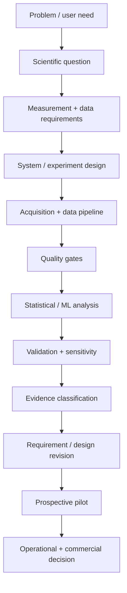

# R&D Operating Model

My research and product-development work converges on a common operating model.

## 1. Problem framing
Translate an ambiguous scientific, clinical, or operational problem into a decision that can be measured.

## 2. Requirements and acceptance criteria
Move from user need -> workflow requirement -> data requirement -> system behavior -> measurable acceptance condition.

## 3. Evidence architecture
Maintain traceability across claim -> implementation -> dataset -> analysis/model -> result -> limitation -> release decision.

## 4. Measurement and data quality
Treat source authority, missingness, timing, artifacts, labels, and event reconstruction as first-class research variables.

## 5. Analysis and model development
Choose the simplest analysis that can answer the question, then evaluate whether more complex modeling adds real decision value.

## 6. Model risk and human authority
Decide what may be automated, what may be suggested, what requires confirmation, and what must remain outside system authority.

## 7. Pilot architecture
Use progressive stages such as setup -> baseline -> silent observation -> assisted workflow -> outcome follow-up -> scale decision.

## 8. Technical claims governance
Distinguish designed, implemented, tested, retrospectively demonstrated, simulated, prospectively observed, operationally effective, and causally effective.

## 9. Research-to-commercialization translation
Connect scientific validity, engineering readiness, workflow adoption, security/compliance, economics, and customer evidence before scaling a technology.
