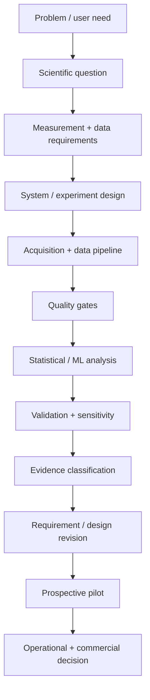

# Research and Development Approach

My research and product-development work converges on a common operating model.

## 1. Problem framing
Translate an ambiguous scientific, clinical, or operational problem into a decision that can be measured.

## 2. Requirements and acceptance criteria
Move from user need -> workflow requirement -> data requirement -> system behavior -> measurable acceptance condition.

## 3. Measurement and data quality
Treat source authority, missingness, timing, artifacts, labels, construct validity, and event reconstruction as first-class research variables.

## 4. Evidence architecture
Maintain traceability across claim -> implementation -> dataset -> analysis/model -> result -> limitation -> release decision.

## 5. Analysis and model development
Choose the simplest analysis that can answer the question, then evaluate whether more complex modeling adds real decision value.

## 6. Validation and scientific inference
Match the validation strategy to the deployment or research decision. Separate statistical significance from effect magnitude, association from prediction, and retrospective evidence from prospective effects.

## 7. Model risk and human authority
Decide what may be automated, what may be suggested, what requires confirmation, and what must remain outside system authority.

## 8. Pilot architecture
Use progressive stages such as setup -> baseline -> silent observation -> assisted workflow -> outcome follow-up -> scale decision.

## 9. Technical claims governance
Distinguish designed, implemented, tested, retrospectively demonstrated, simulated, prospectively observed, operationally effective, and causally effective.

## 10. Communication and organizational learning
Translate the same evidence appropriately for scientists, engineers, clinicians, executives, customers, and investors. Use null results, weak effects, failed assumptions, and technical constraints to revise the next experiment or system requirement rather than defend the original hypothesis.

## 11. Research-to-commercialization translation
Connect scientific validity, engineering readiness, workflow adoption, security/compliance, economics, and customer evidence before scaling a technology.
