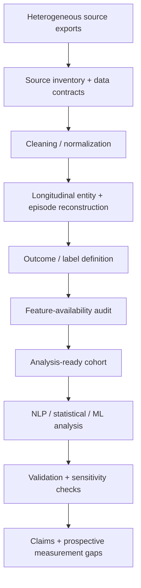

# Clinical Data Science and Real-World Evidence

## Core problems

Operational healthcare data are not automatically research data. Typical failure modes include:

- missingness
- duplicate events
- inconsistent dates
- conflicting statuses
- malformed values
- heterogeneous source formats
- terminology differences
- free-text ambiguity
- incomplete outcome capture
- differing levels of source authority

## Workflow

## Decision rule

When a model fails, the corrective action may be a better algorithm, but it may instead be a better label, data contract, source definition, event model, or telemetry system. Diagnosing that distinction is a core data-science skill.
