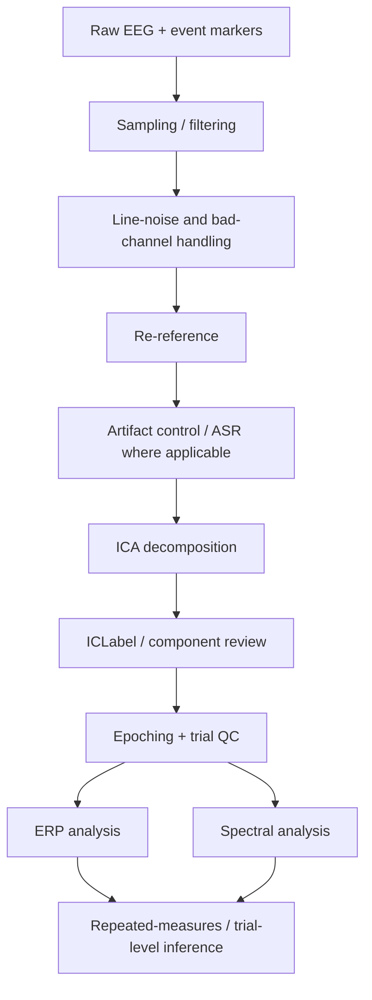

# EEG / ERP / Spectral Processing

## Research use cases

- Cognitive-control and attentional oddball effects
- Auditory notification perturbations
- Mindfulness-related modulation
- ERP components including P2, N2, and P3
- Theta, alpha, beta, and theta/beta-ratio analyses

## Representative pipeline

## Quality principles

- Event timing must be synchronized with the behavioral paradigm.
- Artifact rejection thresholds are part of the inferential design, not a cosmetic preprocessing choice.
- Component-removal decisions should be checked for systematic condition differences.
- ERP windows should reflect the study design and observed grand-average structure.
- Spectral and ERP results should be interpreted alongside behavior rather than as direct one-to-one psychological readouts.

## Tools

BioSemi ActiveTwo, Net Station, MATLAB, EEGLAB, ERPLAB, Infomax ICA, ICLabel, artifact subspace reconstruction, event-locked analysis.
