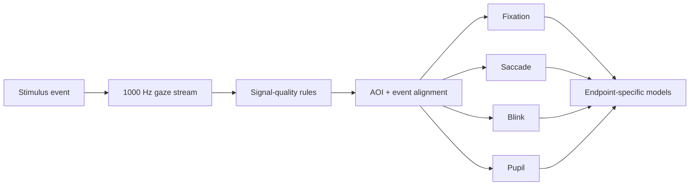

# Eye-Tracking and Physiological Gaze Analysis

## Acquisition

- EyeLink 1000 Plus
- Right-eye recording at 1000 Hz
- 9-point calibration and validation
- Mean validation error target <=0.75 degrees; maximum <=1.50 degrees
- Recalibration across experimental blocks

## Endpoints

- First-fixation latency and duration
- Fixation count / dwell behavior
- First-saccade metrics
- Blink measures
- Pupil magnitude and variability
- Reaction time and accuracy

## Analysis pattern

## Quality principles

- Calibration quality is a study endpoint prerequisite.
- Trial-level signal availability should be quantified before inferential analysis.
- Pupil measurements should preserve the instrument's units unless an external calibration establishes physical units.
- Multiple gaze/physiology endpoints can disagree; interpretation should not collapse them into a single latent state without evidence.
