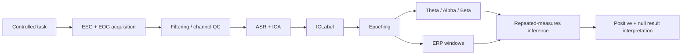

# Technical Notes

The study demonstrates a full neural-analysis chain:

The portfolio does not redistribute publisher figures. The repository instead summarizes reported results and links to the DOI.
