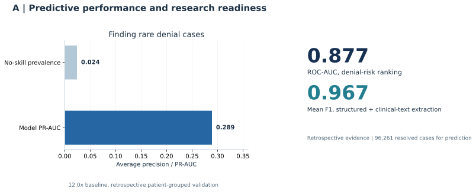
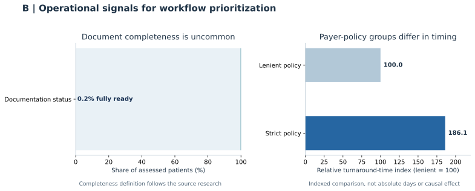
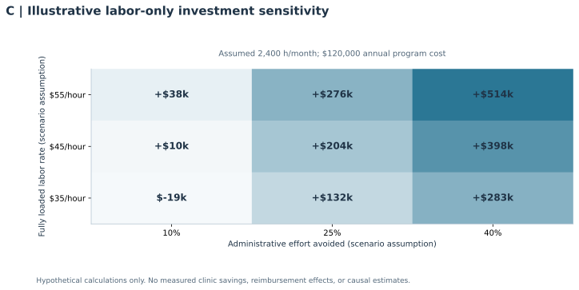

# Applied AI Analytics, Visualization & Decision Support

**Executive analytics report | Oncology prior-authorization research and public-safe analytical demonstration**

This report links a specific analytical question to a visualization and a decision. Figures A and B use publicly summarized **retrospective, single-practice research findings**. Figure C demonstrates **hypothetical labor-cost sensitivity** using explicitly illustrative assumptions, not achieved Hidalga savings. No patient-level or payer-confidential information is included.

## Executive summary

- **Predictive feasibility:** The historical denial-risk model reported **PR-AUC 0.289** against a **0.024 prevalence baseline** (approximately **12 times** the no-skill baseline), with **ROC-AUC 0.877**. These are retrospective ranking metrics, not evidence that staff intervention reduces denials.
- **Workflow priorities:** Only **0.2%** of assessed patients met the study's full documentation-readiness definition. Reported turnaround time in the strict-policy comparison was **86.1% longer** than the lenient comparison. Both findings motivate deeper workflow instrumentation rather than prove a causal payer effect.
- **Investment framing:** The illustrative labor-only model makes the decision contingent on workload, labor cost, achievable efficiency, and annual solution cost. It does **not** incorporate reimbursement recovery or imply observed financial return.

## A. Can a prediction model identify records worth additional review?



**Data and method.** Metrics reproduced from the portfolio's [Metric Provenance](../METRIC_PROVENANCE.md) and [Results](../results.md): 96,261 resolved historical cases, denial prevalence approximately 2.4%, patient-grouped ROC-AUC 0.877, PR-AUC 0.289, and combined clinical-field extraction mean F1 0.967. The chart computes `0.289 / 0.024 = 12.04` for a descriptive comparison to prevalence. Extraction F1 is a separate task and is deliberately displayed separately from the denial model metrics.

**Interpretation.** The model differentiated rare denials better than a no-skill prevalence benchmark in the historical cohort. ROC-AUC, PR-AUC, calibration, operational precision and intervention benefit answer different questions. **No synthetic ROC/PR curve, probability calibration curve or confidence interval is inferred from these aggregates.**

**Decision recommendation.** Retain human-reviewed risk triage as a candidate for prospective silent evaluation. Before workflow adoption, assess discrimination and calibration by time and relevant payer/clinical segments, threshold-specific workload, availability of predictors at the intended decision time, and staff overrides.

**Evidence boundary:** Retrospective, non-interventional, single-site research. The figure does not establish prospective accuracy, reimbursement improvement, or medical-necessity authority.

## B. Which workflow issues should operational teams investigate first?



**Data and method.** The readiness share of 0.2% corresponds to the historical, study-defined fully ready state, with **99.8% displayed as its arithmetic complement**. The payer comparison is represented on a normalized index with lenient-policy TAT set to 100 and strict-policy TAT at `100 x (1 + 0.861) = 186.1`. This **indexed contrast is not absolute turnaround days** and should not be interpreted as a causal effect of payer rules. Both inputs come from summary findings documented in the study and portfolio.

**Interpretation.** Documentation readiness is an observable target for workflow investigation. Turnaround-time differences require careful accounting for event definitions, case mix, cohort selection, payer differences and incomplete action timestamps. They do not by themselves specify which intervention will improve outcomes.

**Decision recommendation.** Prioritize source-of-truth clarification, evidence-completeness telemetry, distinct clock definitions and direct logging of staff actions, payer responses, overrides and case status. Compare actual workflow metrics against a staged baseline before claiming efficiency improvements.

**Evidence boundary:** Retrospective descriptions and derived visual indices. No staff-time reduction, denial reduction or clinical benefit is shown as measured.

## C. Under what assumptions could an analytics intervention justify its cost?



**Data and method.** This is a deliberately **hypothetical** decision-support exercise, not a Hidalga ROI estimate. The reproducible source file specifies 2,400 administrative hours/month, assumed loaded labor rates of $35, $45 and $55/hour, hypothetical effort reductions of 10%, 25% and 40%, and a $120,000 annual program cost. Results are calculated as:

`annual net labor value = monthly hours x 12 x loaded hourly rate x avoided-effort fraction - annual program cost`

The exact scenario grid is available in [`figures/illustrative_sensitivity_table.csv`](figures/illustrative_sensitivity_table.csv). For example, at $45/hour and 25% effort avoided: `2,400 x 12 x $45 x 0.25 - $120,000 = $204,000` annual net labor value. This is a sensitivity result conditional on assumptions, **not a prediction of what a clinic will achieve**.

**Interpretation.** A solution could fail to justify its cost at low achieved-efficiency levels even when a model has favorable retrospective metrics. This distinction prevents conflation of technical feasibility with economic value.

**Decision recommendation.** Require prospective time-and-motion measurements, realistic labor rates, implementation costs, adoption estimates, and an agreed evaluation period. Expand the model to revenue/reimbursement effects **only if independently measured and attributable**. If evidence cannot establish adoption or avoided effort, do not treat hypothetical positive net value as a business case.

**Evidence boundary:** Illustrative assumptions. No historical practice savings, staffing changes or revenue effects were used to generate this figure.

## Technical implementation and reproducibility

The [visualization code](visualize.py) reads [`evidence_and_assumptions.json`](evidence_and_assumptions.json), validates ranges and denominators, computes the scenario table, and rebuilds all three charts as PNG and SVG assets. It uses Python, NumPy, pandas and Matplotlib. The source file separates reported retrospective figures from illustrative assumptions, and tests assert valid bounds, required artifacts and financial arithmetic.

From the repository root:

```bash
python -m pip install -r requirements.txt
python projects/05_clinical_ai_oncology/analytics/visualize.py
pytest -q
```

Source and provenance: [Metric Provenance](../METRIC_PROVENANCE.md), [Clinical AI Project](../README.md), [Clinical AI Results](../results.md), and [Figure Source Notes](figures/SOURCE_NOTES.md). The underlying research report is confidential and intentionally **not included**. Public charts reproduce only previously summarized aggregates.

## Resume evidence, scoped to this portfolio enhancement

- **Analytical visualization:** Developed a reproducible, aggregate-only analytics reporting module presenting retrospective model performance and workflow findings alongside decision-specific methodological limitations. [Code](visualize.py) | [Report](REPORT.md)
- **Technical implementation:** Implemented configurable chart generation, financial sensitivity calculations, evidence-bound data validation and automated tests for a public healthcare AI analytics portfolio. [Source](visualize.py) | [Tests](../../../tests/test_analytics_visualization.py)
- **Strategic decision support:** Created an illustrative labor-cost sensitivity analysis that exposes break-even tradeoffs across staffing cost and administrative-efficiency assumptions without representing modeled value as observed clinic savings. [Model inputs](evidence_and_assumptions.json) | [Scenario output](figures/illustrative_sensitivity_table.csv)

These bullets describe **this new portfolio enhancement**, not separately verified historical project responsibilities or commercial outcomes. Authorship should be described accurately if produced with assistance from coding tools.
