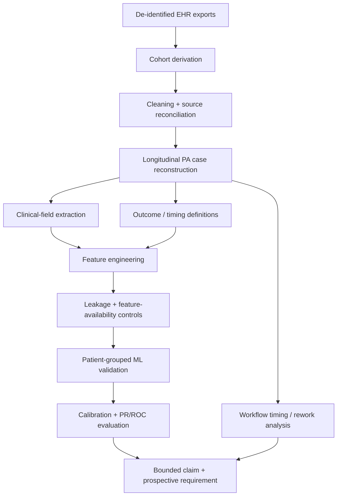

# Methods

## Five research questions

1. **Evidence extraction** - Can structured and free-text oncology records support reliable extraction of PA-relevant clinical evidence?
2. **Denial-risk triage** - Can pre-decision information rank rare denial cases for additional staff review?
3. **Workflow timing** - Where does turnaround-time burden occur, how does it vary, and what next-action rules are plausible?
4. **Trial-associated burden** - Do trial-associated cases show different rework, approval, appeal, or resubmission patterns?
5. **Operational value** - What workflow/economic value is plausible under explicit assumptions?

## Analytic architecture

## Data-quality questions

- Is the missing value truly absent, or present in another source?
- Do two systems disagree about status or date?
- Is an outcome label complete enough to train against?
- Was a feature available before the decision point?
- Does an event represent a new case, a retry, a continuation, or duplicate documentation?

## Model-risk controls

- Patient separation between train and test
- Leakage-exclusion review
- PR-AUC alongside ROC-AUC because denial is rare
- Calibration
- Threshold-to-workload translation
- Temporal and subgroup stability checks
- Human-review boundaries for uncertain/high-risk cases
