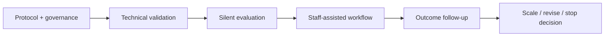

# Prospective Pilot Logic

The next study was designed as a staged learning system rather than a product demonstration.

## Proposed primary endpoint

At least **20% reduction in median chart-search and documentation-review time** versus a prespecified comparator.

## Secondary measures

- time to submit
- rework
- staff use
- model accuracy
- approvals / denials / P2Ps
- recommendation exposure
- user overrides and reasons
- payer response
- workload

The design demonstrates an important R&D principle: **if historical data cannot identify the causal mechanism, instrument the mechanism prospectively before increasing system authority.**
