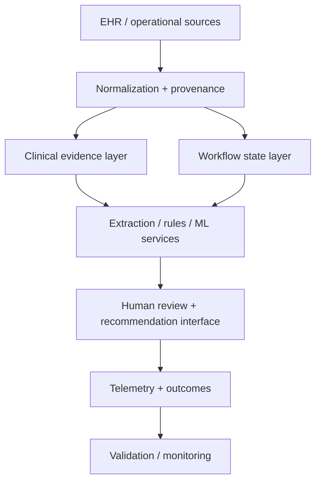

# Public-Safe Architecture View

This page intentionally omits partner-specific interfaces, production credentials, proprietary payer criteria, and trade-secret implementation details.

## Design patterns demonstrated

- Source-grounded evidence
- Provenance and field-level traceability
- Hybrid structured data + targeted NLP
- Separate validation strategies for extraction, deterministic rules, and prediction
- Human-in-the-loop authority boundaries
- Versioned schemas / contracts
- Prospective telemetry
- Security and privacy as architecture constraints
